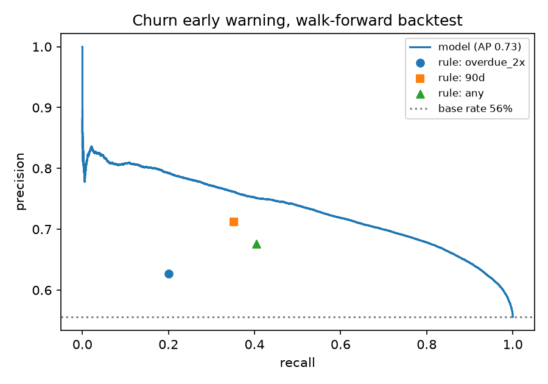

# Retail Analytics on Public Data: dbt Model Layer, Churn Early Warning, Month-End Forecasting

An end-to-end analytics project on the public **UCI Online Retail II** dataset (about 1.07M invoice lines from a UK online wholesaler, December 2009 to December 2011). It shows the workflow I use for sales analytics: a tested model layer, a data contract in front of it, and models that are judged against simple baselines with backtests that cannot see the future.

Author: Junyi (Stanley) Ye · [jyye.org](https://jyye.org)

## What is in here

| Piece | What it does | Where |
|---|---|---|
| Data contract | 16 checks on the raw file (schema, date window, cancellations, ID formats, duplicates, gaps) that stop a bad file before modeling | `scripts/data_contract.py` |
| Model layer | dbt + DuckDB: staging, order-line and order facts, customer, product and date dimensions, weekly and monthly marts | `dbt_project/` |
| Tests | 37 dbt tests: keys, relationships, and reconciliation tests that tie every mart back to the order lines to the penny | `dbt_project/models/marts/schema.yml`, `dbt_project/tests/` |
| Churn early warning | Weekly walk-forward backtest of a logistic model against practical alert rules, at the same list size | `analysis/churn_backtest.py` |
| Month-end forecast | Forecast the month's revenue from day 7, 14 and 21 and compare five methods | `analysis/month_end_forecast.py` |

## Results

### Churn early warning

Each Friday, which active repeat customers will place no order in the next 60 days? 54 test weeks, about 131K customer-weeks, base lapse rate 56%. The model for each week is trained only on earlier snapshots whose 60-day outcome is already known.

| Compared with this rule | Avg weekly list | Rule precision / recall | Model precision / recall, same list size | Recall gain, 90% CI |
|---|---|---|---|---|
| Overdue by 2x own order cycle | 431 | 63% / 20% | 80% / 26% | +5.0 to +5.9 pts |
| No order for 90 days | 664 | 71% / 35% | 78% / 38% | +2.9 to +3.4 pts |
| Either rule | 805 | 68% / 40% | 76% / 46% | +4.9 to +5.6 pts |

Ranking quality: AUC 0.72, average precision 0.73 against a random baseline of 0.56. The strongest signals are recent spend and order count (protective) and how overdue a customer is relative to their own cycle. Full report: [`results/churn_backtest.md`](results/churn_backtest.md).



### Month-end revenue forecast

Median absolute percentage error over 19 months:

| Forecast day | Run rate | Trailing 28 days | Pace curve | Account cycle | Blend |
|---|---|---|---|---|---|
| 7 | 7.6% | 11.8% | 10.1% | 20.0% | 13.5% |
| 14 | 7.5% | 9.9% | 10.4% | 16.7% | 10.1% |
| 21 | 6.4% | 4.4% | 6.1% | 12.3% | 8.7% |

On this dataset the simple run rate is hard to beat. The account-cycle method, which builds the forecast from each customer's own order cycle, has the smallest bias by day 21 (+0.7%) but much higher variance: with about 5,800 customers ordering irregularly, individual due dates are noisy, and the errors do not cancel as well as a pooled run rate does. A method like this pays off when a small number of accounts drive most of the volume and order on a regular cycle. That is a property of the business, not something to force with tuning. Full report: [`results/month_end_forecast.md`](results/month_end_forecast.md).

## Design decisions

- **Exact duplicates are removed in staging.** 34,337 lines (3.2%) repeat the same invoice, item, quantity, price, timestamp and customer, worth about £0.56M. The contract reports them; staging keeps one copy.
- **Sales exclude cancellations, returns, and non-product codes** (postage, manual adjustments, bank charges, gift vouchers, test codes), and lines without a customer ID. Cancellations are kept in a separate monthly mart.
- **Every mart reconciles.** Monthly revenue, customer totals and the customer-week mart must match the order lines to the penny, or the build fails.
- **No look-ahead.** Churn features use only orders before the snapshot. Each model is trained only on snapshots whose outcome window has closed. Forecast calibration uses only earlier months.
- **Fair comparison.** The churn model is scored at exactly the rule's weekly list size, so better numbers mean better ranking, not a longer list.

## Run it

Requires [uv](https://docs.astral.sh/uv/). The full pipeline takes a few minutes, most of it the one-time download.

```bash
./run_all.sh
```

Or step by step:

```bash
uv sync
uv run python -I scripts/download_data.py      # UCI Online Retail II -> data/raw/*.parquet
uv run python -I scripts/data_contract.py      # 16 checks; exits non-zero on any FAIL
cd dbt_project && ../.venv/bin/dbt build --profiles-dir . && cd ..
uv run python -I analysis/churn_backtest.py
uv run python -I analysis/month_end_forecast.py
```

## Repository layout

```
scripts/        download and data-contract checks
dbt_project/    dbt models (staging, marts) and tests
analysis/       churn backtest, month-end forecast
results/        generated reports and figures
```

## Data and license

Code: MIT. Data is not committed. It is downloaded from the UCI Machine Learning Repository under CC BY 4.0: Chen, D. (2012). *Online Retail II* [Dataset]. https://doi.org/10.24432/C5CG6D
