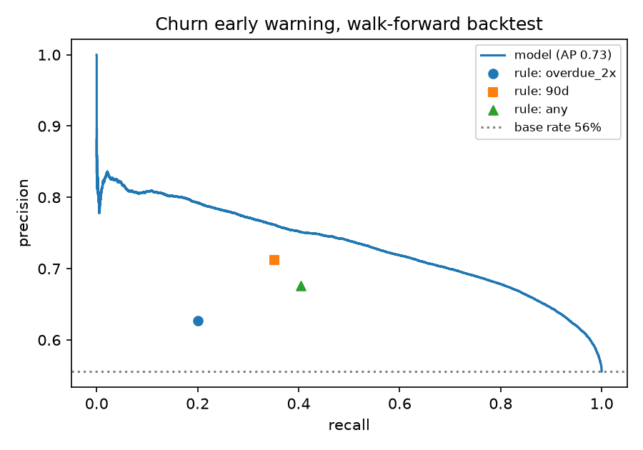

# Churn early warning: walk-forward backtest

- Snapshots: 54 weekly test Fridays, 2010-09-24 to 2011-09-30
- Customer-weeks scored: 130,701; customers: 3,718; base lapse rate: 56%
- Label: no order in the next 60 days. Pool: repeat customers with an order in the last 180 days.
- Ranking quality: AUC 0.72, average precision 0.73 (random = 0.56).

## Same list size as each rule

| Rule | Avg weekly list | Rule precision | Rule recall | Model precision | Model recall | Recall gain, 90% CI (week bootstrap) |
|---|---|---|---|---|---|---|
| overdue_2x | 431 | 63% | 20% | 80% | 26% | +5.0 to +5.9 pts |
| 90d | 664 | 71% | 35% | 78% | 38% | +2.9 to +3.4 pts |
| any | 805 | 68% | 40% | 76% | 46% | +4.9 to +5.6 pts |

## What the model leans on (standardized coefficients, final fit)

| Feature | Coefficient |
|---|---|
| log_rev_180 | -0.51 |
| log_orders | -0.45 |
| overdue_ratio | +0.25 |
| log_gap | +0.24 |
| log_recency | +0.12 |
| log_aov | +0.12 |
| trend_90 | -0.04 |

