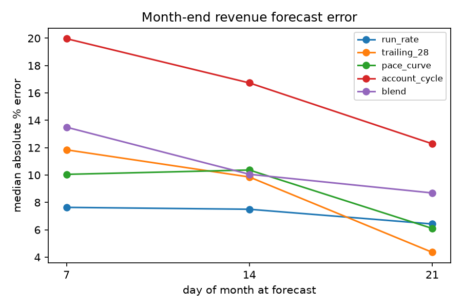

# Month-end revenue forecast

- Evaluation months: 2010-05 to 2011-11 (19 months), three forecast days each.
- Error = |forecast − actual| / actual. Every learned parameter (pace share, hit rate, new-customer baseline) uses only earlier months.

## Median absolute percentage error

| Forecast day | Run rate | Trailing 28 days | Pace curve | Account cycle | Blend (pace + cycle) |
|---|---|---|---|---|---|
| 7 | 7.6% | 11.8% | 10.1% | 20.0% | 13.5% |
| 14 | 7.5% | 9.9% | 10.4% | 16.7% | 10.1% |
| 21 | 6.4% | 4.4% | 6.1% | 12.3% | 8.7% |

## Median bias (forecast ÷ actual − 1; negative = under-forecast)

| Forecast day | Run rate | Trailing 28 days | Pace curve | Account cycle | Blend (pace + cycle) |
|---|---|---|---|---|---|
| 7 | -3.3% | -2.6% | +2.0% | -2.6% | +5.9% |
| 14 | +1.9% | -1.8% | +3.8% | -3.2% | +3.2% |
| 21 | +3.2% | +2.8% | +1.5% | +0.7% | -1.1% |

Best learned method: **Pace curve**, which beats run rate in 42% of months on day 7, 42% of months on day 14, 58% of months on day 21.

About 19 months per forecast day, so read differences as direction, not as a significance claim.

